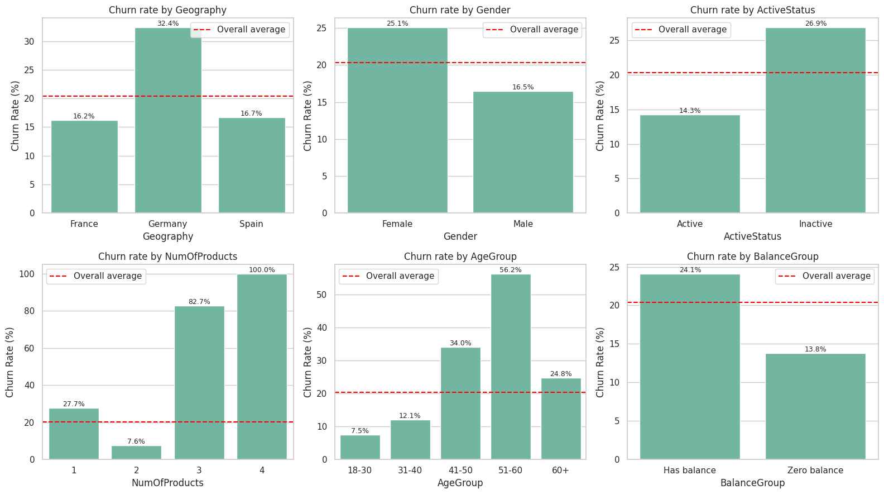
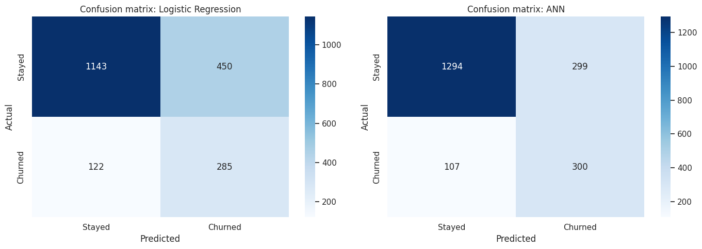
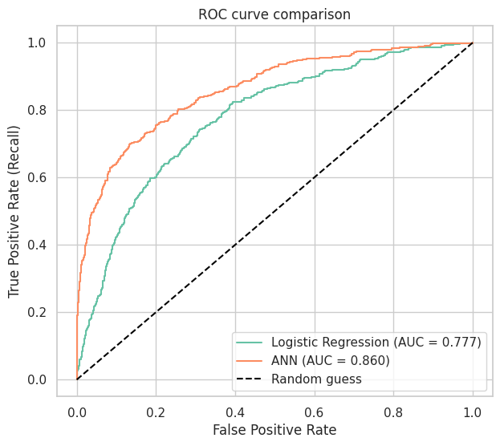

# Customer Churn Analysis and Prediction

In this project I analysed why customers leave a bank and built a model that flags which customers are likely to churn.

## Dataset

- Bank Customer Churn dataset (`Churn_Modelling.csv`)
- 10,000 customers, 14 columns
- Target column: `Exited` (1 = left the bank, 0 = stayed)

## What I did

1. Checked data quality (no missing values or duplicates)
2. Removed ID columns that don't affect churn
3. Did EDA to find churn patterns by country, gender, age, activity, products and balance
4. Wrote down key insights and business recommendations
5. Built a Logistic Regression model as a baseline
6. Built an ANN with class weights, dropout and early stopping to handle the imbalanced data
7. Compared the models using recall, F1 score, confusion matrix and ROC-AUC
8. Gave every customer a churn risk score (Low / Medium / High)

## Key insights

- **20.4%** of customers churned, and they held **24%** of the bank's total balance
- **Germany** has double the churn rate (**32%**) of France and Spain (**16 to 17%**)
- **Age** is the biggest factor. Churn goes from **7.5%** (ages 18 to 30) to **56%** (ages 51 to 60)
- **Inactive members** churn almost twice as much as active ones (**27% vs 14%**)
- Customers with **2 products** churn the least (**8%**), while most customers with **3 or 4 products** left
- **Female** customers churn more than male customers (**25% vs 17%**)



## Recommendations

- Look into the German market first, since it has the highest churn and the highest balances
- Give retention offers to customers aged 40 to 60
- Run re-engagement campaigns for inactive members
- Cross-sell a second product to single-product customers

## Model results

| Model | Accuracy | Recall (churners caught) | F1 Score | ROC-AUC |
|---|---|---|---|---|
| My first ANN (no class weights) | 86% | 51% (200 of 393) | - | not measured |
| Logistic Regression (balanced) | 71% | 70% | 0.50 | 0.78 |
| **Final ANN (class weights + early stopping)** | 80% | **74%** (300 of 407) | 0.60 | **0.86** |

I focused on **recall** instead of accuracy because the data is imbalanced (80/20). A model that always says "won't churn" already gets 80% accuracy, and missing a customer who is about to leave costs the bank more than a false alarm. My first version (commit `0386de6`) had higher accuracy but missed half the churners.




## Risk tiers

| Risk tier | Customers | Actual churn rate |
|---|---|---|
| High | 1,598 | **70.2%** |
| Medium | 2,556 | 24.0% |
| Low | 5,846 | **5.2%** |

The tiers line up well with what actually happened, so the bank could focus its retention budget on the High tier first.

## Files

- `Churn Rate Prediction.ipynb` : full analysis and models, with all outputs
- `Churn_Modelling.csv` : dataset
- `figures/` : charts used in this README

Running the notebook also creates `churn_dashboard_data.csv` (every customer with their risk score).

## How to run

```
pip install -r requirements.txt
```

Then open `Churn Rate Prediction.ipynb` in Jupyter and run all cells. Neural network training has some randomness, so the ANN numbers can shift by a point or two between runs.

## Tools

Python, Pandas, NumPy, Matplotlib, Seaborn, Scikit-learn, TensorFlow (Keras)
